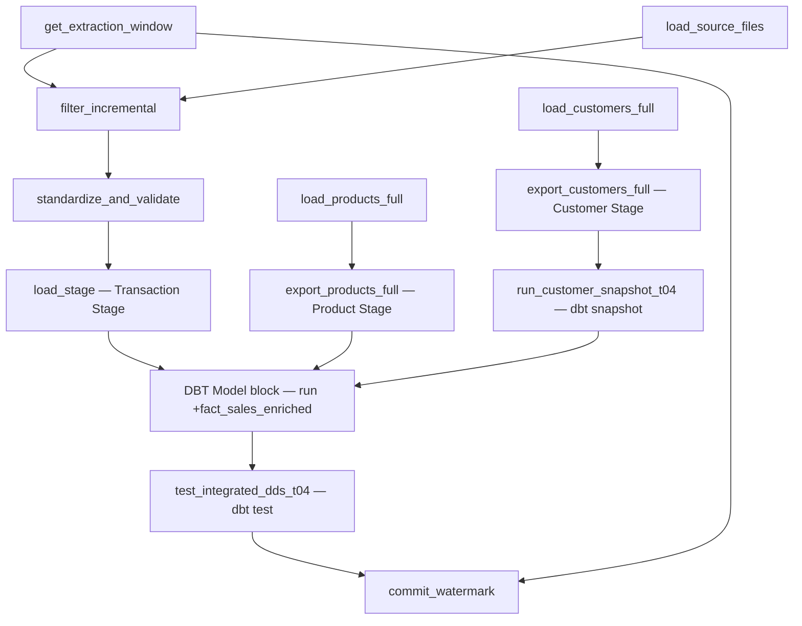

# Mage orchestration — hướng dẫn lắp trong Edit pipeline (tự động theo dependencies)

Giữ nguyên các block của Tutorial 02–03, **đổi đường downstream** cho `commit_watermark` để chỉ chạy sau bước kiểm thử:



Khi chọn DBT Model block: Project `dbt/dbt_project`, target `dev`, **All models**, command `run`, model selection `--select +fact_sales_enriched`.

Cả ba nhánh Stage phải kết thúc trước DBT Model block. Các block chỉ dùng dependency để điều phối; dbt tự đọc dữ liệu trực tiếp từ PostgreSQL qua `source()` / `ref()`.

**Quan trọng:** Từng lần chạy cần cùng bộ `product_file`, `customer_file`, `cet_override` để giữ trạng thái tương ứng của batch.

## Thứ tự mô phỏng bằng terminal khi debug (nếu chưa nối Mage)

Sau khi ba bảng Stage đã được nạp đúng phiên bản:

```bash
docker compose exec mage bash
cd /home/src/lab_project/dbt/dbt_project
dbt snapshot --select customers_snapshot
dbt run --select +fact_sales_enriched
dbt test --select +fact_sales_enriched
```

Trên Mage, **không dùng CLI này thay cho pipeline** khi cần commit watermark; chỉ dùng để kiểm tra riêng từng bước.
